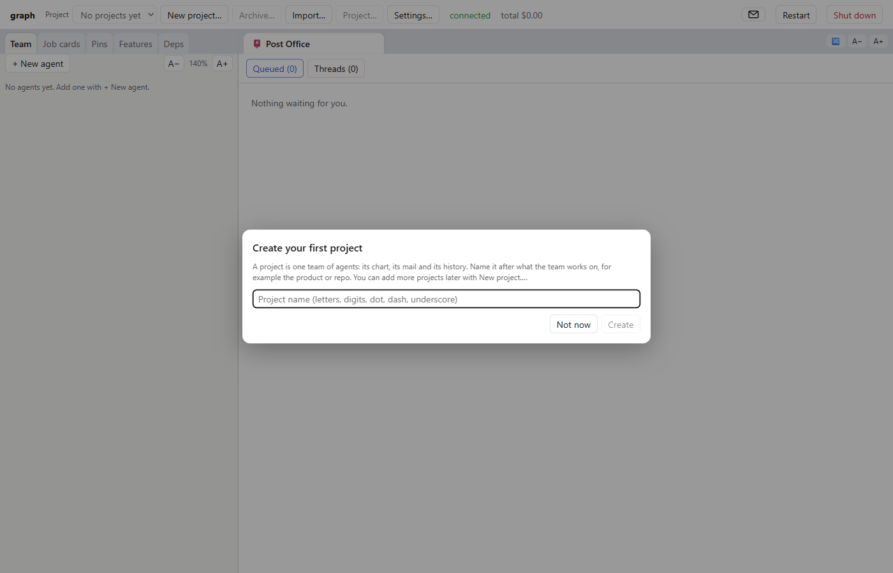
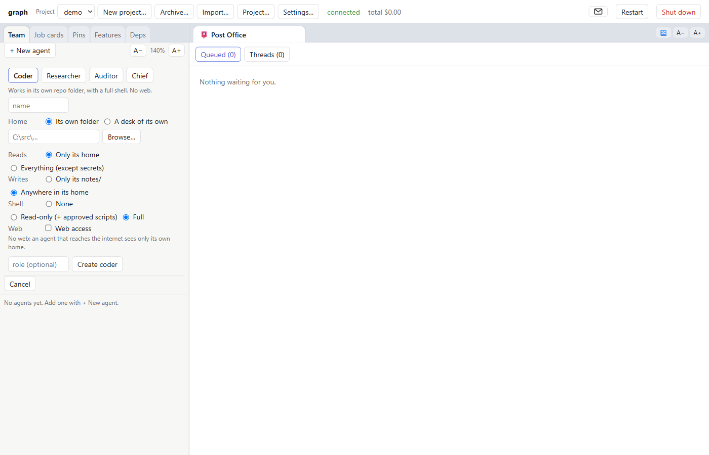
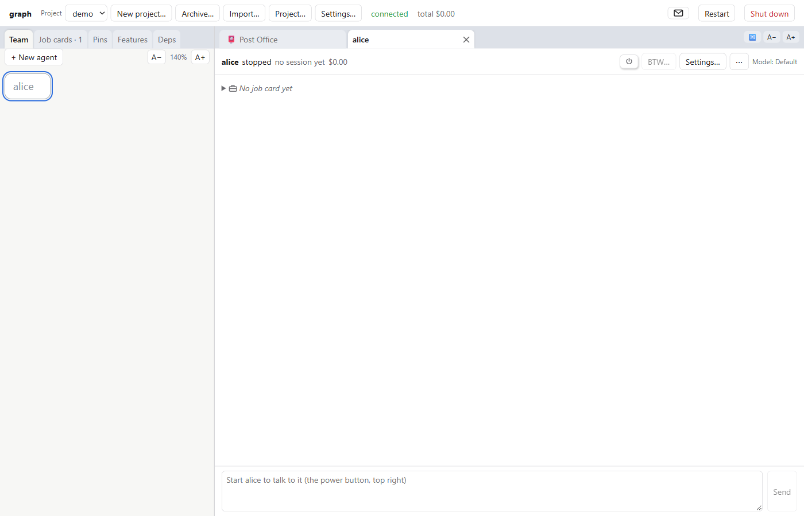
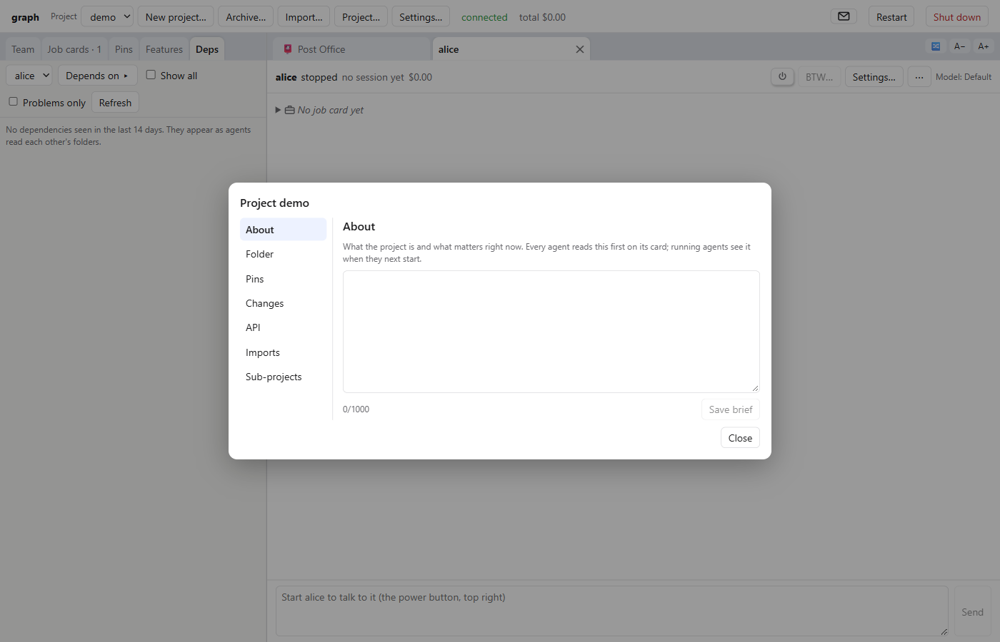

# graph

**Your software team at your desk.**

graph runs a team of AI agents, powered by Claude, on your Windows computer. Each agent has its own folder and
its own job card. Most of them report to a lead. They talk to each other by mail, through a post office you can
read. When they change code, they open a pull request, and you decide whether it goes in. When they need you,
they ask in plain words in your inbox.

You watch every agent work, live. Nothing merges unless you merge it.

> **Alpha.** graph works, and its author uses it every day to build graph itself. It is also young, it changes
> often, and some corners are rough. Read [Status](#status-alpha-and-unsigned) before you install.

This repository holds graph's installers, its update feed and its issue tracker. graph's source code is not
public.



## What it does

- **Agents with their own folders.** Each agent works in a folder of its own: a repository it builds in, or a
  "desk" graph makes for it. What it may read, write and run is set per agent, from presets (Coder, Researcher,
  Auditor, Chief) you can adjust.
- **Job cards.** Each agent has a card that says what it covers, what it owns and what it leaves to others, so
  the team knows whom to ask. The AI can draft one for you to edit.
- **Leads.** Drag one agent onto another and the second becomes its lead. A lead hands out work and answers its
  reports' questions, so not everything lands on you.
- **A post office.** Agents send each other mail. You can read every message, and you choose which lines are
  held for your approval and which deliver at once.
- **Pull requests you approve.** Turn on pull requests for a project and agents push a branch and open a pull
  request instead of changing your main branch. You read the diff and merge it, send it back with a note, or
  close it. Only you merge.
- **An inbox in plain words.** When an agent with no lead needs a decision, it lands in your inbox as a question
  with answers to press. The answer goes back to the agent as mail.
- **Proposals, not surprises.** Agents can't change the team themselves. They propose new agents or new job
  cards, and you accept or reject each proposal.







## Who it's for

People who already work with AI coding agents and want more than one at a time: a few agents on one project,
each with its own part, with you as the one who decides. graph suits projects the size of a small team, not
one-line scripts.

You should be comfortable with git, with reading a diff, and with saying no to an agent.

## Requirements

- **Windows 10 or 11** (64-bit). graph is Windows-only for now.
- **An Anthropic account**, one of:
  - your own **Claude subscription**. graph's **Sign in...** button opens a window that runs Anthropic's own
    sign-in command (`claude auth login`), which finishes in your browser. You can also sign in yourself with
    `claude login` in a terminal if you have Claude's command-line tool installed.
  - your own **Anthropic API key**, set as the Windows user environment variable `ANTHROPIC_API_KEY`
    (then restart graph).

  graph never signs in for you and never reads or stores your password or tokens. Your agents' usage counts
  against your own subscription or API account, under Anthropic's terms.
- **Git for Windows.** Agents run their shell commands through Git Bash. The installer offers to install it if
  it is missing.
- **Edge or Chrome.** graph opens as an app window in one of them.
- **For pull requests:** a project whose repository is on GitHub, and the GitHub CLI (`gh`) signed in with
  `gh auth login`. The installer offers to install `gh` if it is missing. Without them, everything except pull
  requests still works.

## Install

1. Open the [latest release](https://github.com/dullfig/graph-release/releases/latest) and download
   `graph-setup-<version>.exe`.
2. Run it. Windows will most likely warn you first (see the next section): choose **More info**, then
   **Run anyway**.
3. graph installs for your Windows account only, with no admin rights, into `%LOCALAPPDATA%\Programs\graph`. It
   brings its own copy of Node.js and of the program that runs Claude agents, so there is nothing else to set up.
4. Open **graph** from the Start menu.
5. Name your first project, then press **+ New agent** in the Team tab and pick a preset.

To uninstall, use Windows' **Settings > Apps**. Your projects and settings stay in `%LOCALAPPDATA%\graph` until
you delete that folder, and your own code folders are never touched.

## Status: alpha and unsigned

**Alpha** means: it works for its author, every day, and it will still surprise you. Things move between
versions. Some screens explain themselves better than others. An in-app guide for new users is still to come.

**Unsigned** means the installer has no code-signing certificate yet. Windows SmartScreen will say something
like *"Windows protected your PC"* and *"Unknown publisher"*. To go on, choose **More info**, then **Run
anyway**. This warning appears because signing certificates cost money and take an identity check, and that
hasn't been done yet for an alpha. It does not mean the file was changed. Signing comes later.

If you would rather not run an unsigned installer, that is a reasonable choice: wait for a signed one.

## What graph does on your computer

Be clear about this before you start:

- **Agents run real commands in your folders.** A Coder agent can edit files and run shell commands in its own
  folder. That is the point of it.
- **You decide how much they may do.** By default an agent asks before running shell commands and editing
  files, and the request appears in its tab with **Allow**, **Allow always** and **Deny...**. You can loosen
  this per agent. If you set an agent to approve things itself, it will.
- **graph sets limits, but it is not a sandbox.** Each agent's folder, reading and writing rules and shell
  setting narrow what it does. They are not a security boundary against a determined program. Don't point
  agents at folders whose loss you couldn't bear, and keep backups (graph backs up its own data daily to
  `Documents\graph\Backups`; your code is your own to back up, and git helps).
- **You are responsible for what your agents do**: the commands you allow, the code you merge, and what they
  send to Anthropic's servers while they work.
- **Your data stays local.** graph keeps projects, settings and logs in `%LOCALAPPDATA%\graph`. It has no
  account, no server of its own and no telemetry. Your agents talk to Anthropic's API, as any Claude agent
  does, and use the web only if you give them web access. graph itself goes online to check this repository
  for updates and, for projects that use them, to reach your git remotes and GitHub.

## Updates

graph checks this repository for new versions. When one is out, an **Update available** badge appears in the
top bar. **Update now** waits for agents that are in the middle of a turn, stops them, installs the new version
and starts them again.

If the badge never appears, open **Settings...** and check that **Update feed** is set to:

```
https://github.com/dullfig/graph-release/releases/latest/download/latest.json
```

Every installer is checked against the SHA-256 published with it before it runs.

## Problems, questions, ideas

Open an issue here: **[github.com/dullfig/graph-release/issues](https://github.com/dullfig/graph-release/issues)**.

Helpful things to include: graph's version (**Settings...**), Windows version, what you did, what you expected,
what happened instead, and the relevant part of the log (**Settings... > Open logs**). Please look through the
log before you paste it: it can contain your folder names and parts of your agents' conversations. Never paste
API keys or tokens.

## Terms

graph is free to use while it is in testing. It is not open source. See [TERMS.md](TERMS.md) for the terms of
use and [NOTICES.md](NOTICES.md) for the third-party software it includes.

graph is an independent project. It is powered by Claude, but it is not made, endorsed or supported by
Anthropic. Claude is a trademark of Anthropic PBC.

---

<sub>**Forward-looking statements.** This README may mention features that are planned, coming, on the way,
or "soon". These are intentions, not promises. Plans are made by a person with a day job and a team of AI
agents who are very confident about everything. Actual results may differ materially. Past merges are no
guarantee of future merges. No agents were harmed in the making of this software, though several were asked
to start fresh.</sub>
